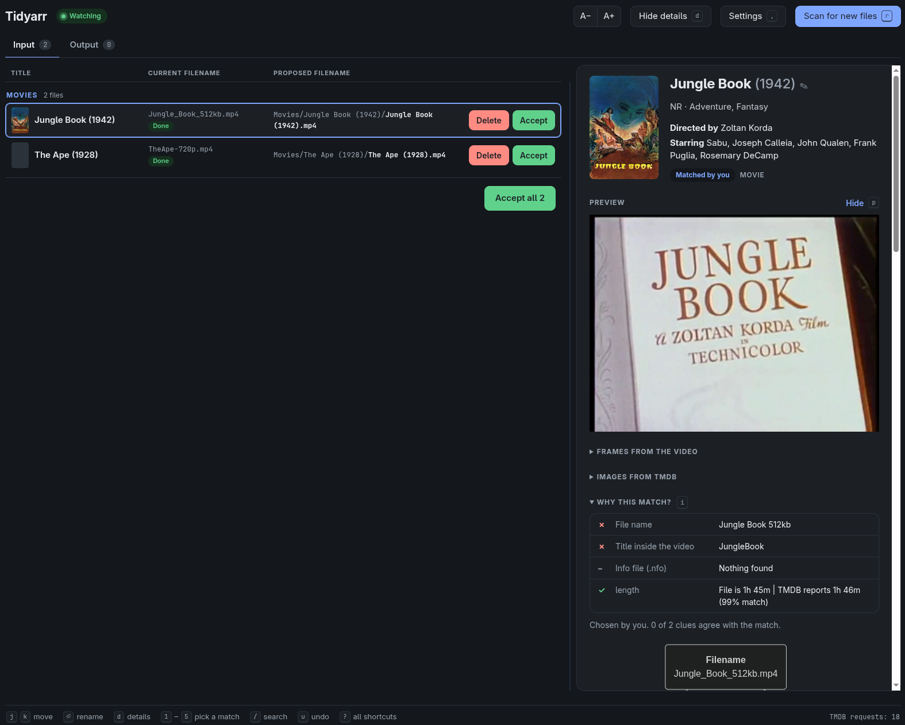

# tidyarr

Sorts downloaded TV episodes and movies into a tidy library. It works out what each video file is from its filename,
the title tag inside it, and any `.nfo` beside it. TMDB confirms the match, and the file is moved into place under a
Sonarr/Radarr-style naming format. When the match is clear it's resolved automatically, and anything else waits for you
to decide in a local review web UI. Decisions are remembered, so a file is never asked about twice.



## Install

Download the executable for your OS from [Releases](https://github.com/davidpellerin/tidyarr/releases) (Linux x86_64,
macOS arm64), or build it from source (below). `ffprobe` (from FFmpeg) should be on your `PATH`.

You'll need a TMDB API key (the 32-character "API Key", not the Read Access Token). Add it in the app's Settings, or set
`TMDB_API_KEY`.

## Usage

```sh
tidyarr --input-root ~/Downloads/input --output-root ~/Videos
```

This starts the review UI on `127.0.0.1` and opens it in your browser. The server runs in the background and stops
itself a few minutes after the page is closed. `tidyarr --stop` stops it sooner. `tidyarr --help` lists the other
options.

Settings (the folders, naming formats, TMDB key) are kept in `~/.config/tidyarr/config.json` on Linux.

## Development

Requires Python 3.12. `make setup` installs [uv](https://github.com/astral-sh/uv) if it's missing.

```sh
make setup   # create .venv with the pinned dependencies
make test    # run the tests
make serve   # run the review UI from source
make dev     # same, restarting on code changes
make build   # bundle a single executable at dist/tidyarr
make install # copy it to ~/.local/bin
```

`make help` lists every target.

## License

Copyright (C) 2026 David Pellerin. Released under the GNU General Public License v3.0; see [LICENSE](LICENSE).
